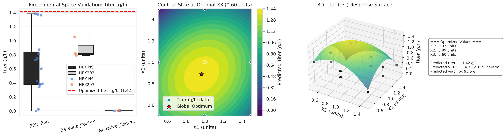

# 🧬 In Silico Bioprocess Optimization: From DoE to Deep Learning

Can we find the best conditions for a mammalian mAb bioprocess with fewer bioreactor runs? This repository compares three ways to do it on simulated cell-culture data: classical **Design of Experiments**, **mechanistic ODE models**, and **machine learning** (Bayesian optimization and physics-informed neural networks).

## 📊 Headline results

| Approach | Notebook | Result |
|---|---|---|
| Box-Behnken DoE + response surface model | `Box_Behnken_DoE_example.ipynb` | **15 runs reach 99.8%** of the achievable titer; the optimum lands within 0.04 coded units of the true peak |
| Bayesian optimization (Gaussian process) | `4_In_Silico_Optimization.ipynb` | **20 runs reach 95%** of the achievable titer |
| Physics-informed neural network (PyTorch) | `3_Physics-Informed Neural Networks.ipynb` | Recovers growth and production rates **within 5%** from 15 noisy samples |
| Hybrid "grey box" model + Bayesian optimization | `3_Physics-Informed Neural Networks.ipynb` | Predicts unseen conditions within ~4% near the optimum; its suggested conditions reach **97.5%** of the true maximum |

<p align="center">
  
</p>

*All data are synthetic, generated from known equations. That is deliberate: because the true optimum is known, every result above can be checked against the truth, which real experiments cannot do.*

## 🧭 The three modelling philosophies

1. **Black box: empirical surrogate models (DoE).** Screening and optimization designs, quadratic response surfaces, stepwise model reduction that respects the principle of marginality, with the final model chosen by AIC and adjusted R², plus constrained multi-objective optimization (SLSQP) that keeps viable cell density and viability above set limits.
2. **White box: mechanistic models (ODEs).** Monod growth kinetics, glucose consumption and Luedeking-Piret mAb production, simulated over a 14-day batch with `scipy.integrate.odeint`.
3. **Grey box: hybrid and physics-informed ML.**
   * A classic **PINN** that uses `torch.autograd` to enforce the ODEs inside the loss function while learning the kinetic constants.
   * A **hybrid model** in which a neural network predicts $\mu_{max}$ and $\beta$ from temperature and pH, and a differentiable Runge-Kutta solver written in PyTorch turns them into growth curves. Errors are backpropagated through the solver.
   * **Bayesian optimization** (`scikit-optimize`) that balances exploration and exploitation to find peak titer with few runs.

## 📂 Notebooks

| Notebook | What it covers |
|---|---|
| `1_DoE_Bioprocess_Simulation.ipynb` | Warm-up toy example: screening and quadratic optimization on a simple simulated process |
| `2_Ordinary_Diferential_Equations_Integrations.ipynb` | The mechanistic model: Monod and Luedeking-Piret ODEs |
| `3_Physics-Informed Neural Networks.ipynb` | PINN, hybrid grey-box model, and Bayesian optimization on the learned model |
| `4_In_Silico_Optimization.ipynb` | Bayesian optimization with Gaussian processes, checked against the true optimum |
| `5_ODE-Constrained Bayesian Optimizer.ipynb` | Bayesian optimization driving the ODE simulator |
| `Box_Behnken_DoE_example.ipynb` | Full DoE workflow: randomized plate layout with controls, RSM model reduction, constrained optimization, validation |

`src/RSM_reduction_optimizer.py` holds the stepwise RSM model-reduction class used by the Box-Behnken notebook.

## ▶️ Getting Started

```bash
git clone https://github.com/Efrazar/in-silico-bioprocess-optimization.git
cd in-silico-bioprocess-optimization
python -m venv .venv
source .venv/bin/activate      # Windows: .venv\Scripts\activate
pip install -r requirements.txt
jupyter lab
```

Package versions are pinned in `requirements.txt` (tested on Python 3.13). Conda users can run `conda env create -f environment.yml` instead.

PyTorch is only needed for notebook 3, which runs on a laptop CPU in about 2 minutes. The default Linux install also downloads GPU libraries (several GB). To install the smaller CPU-only build first, run `pip install torch==2.15.0 --index-url https://download.pytorch.org/whl/cpu`.

## 🛠️ Tech Stack
Python · NumPy · pandas · SciPy · statsmodels · pyDOE3 · scikit-learn · scikit-optimize · PyTorch · matplotlib · seaborn

## ⚠️ Limitations
* Simulated data only. The models are tested against the equations that generated the data, so real cells, with model mismatch, batch effects and assay drift, would give larger errors.
* The mechanistic model is a batch process with fixed yield and affinity constants. Fed-batch feeding and more kinetic parameters are natural next steps.

---
*Created by [Efrazar](https://github.com/Efrazar). Released under the [MIT License](LICENSE).*
