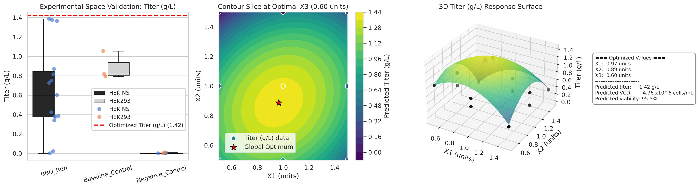

# **Bioprocess Optimization via Response Surface Methodology (RSM) & Multi-Objective Constrained Optimization** 
# `Box_Behnken_DoE_example.ipynb`

## **📌 Project Overview**

This repository showcases an end-to-end data science and statistical engineering workflow for optimizing an upstream cell culture bioprocess. Operating within a simulated Quality by Design (QbD) framework, this project applies a 3-factor Box-Behnken Design (BBD) to model and maximize critical quality attributes (CQAs) while strictly adhering to biological constraints.

The entire workflow is documented and executable within the core Jupyter notebook: `Box_Behnken_DoE_example.ipynb`.

## **🛠️ Key Technical Highlights**

- **Design of Experiments (DoE):** Leverages a 3-factor, 3-level Box-Behnken design matrix to efficiently profile quadratic response surfaces with minimal experimental runs.
- **Information Criteria Model Selection:** Avoids automated underfitting by using Akaike Information Criterion (AIC) and adjusted R² rather than strict, arbitrary p-value cutoffs to identify true parsimonious models.
- **Constrained Multi-Objective Optimization:** Implements a Sequential Least Squares Programming (**SLSQP**) algorithm to maximize product yields under strict biological thresholds.
- **Advanced Response Surface Slicing:** Utilizes 2D contours and 3D surface mapping dynamically sliced through optimal coordinate planes to isolate and highlight high-impact process variables.

## **🚀 The Optimization Pipeline**

### **1\. Data Ingestion & Phenomenological Simulation**

The workflow starts by creating experimental matrix template using `pyDOE3`. In-silico data generation simulates true cell culture responses based on biological behaviors:

- **Volumetric Titer:** Governed by a parabolic curve peaking near mid-to-high concentrations.
- **Viable Cell Density:** Penalized by toxic components accumulation.
- **Viability (%):** Simulates a threshold-based metabolic toxicity penalty when the concentration of determined components exceed a critical ceiling.

### **2\. Statistical Pre-processing & Stepwise Reduction**

Prior to modeling, the design space isolates orthogonal BBD runs from control groups. Normality is statistically validated via Shapiro-Wilk testing across all CQAs.

An automated backward stepwise elimination algorithm `RSM_reduction_optimizer` filters out non-significant interaction and quadratic terms.

💡 **Data Science Insight:** Rather than allowing the automated algorithm to reduce the model purely based on a standard cutoff, each model is finalized manually at the iteration with the lowest **AIC** and the highest **adjusted R²** (iteration 1 for titer, 3 for VCD, 4 for viability). This intentional intervention prevents underfitting and retaining valuable explanatory variance.

### **3\. Multi-Objective Optimization via SLSQP**

To transition from a statistical surface to an engineering reality, a multi-objective optimization problem is solved using the **SLSQP (Sequential Least Squares Programming)** optimizer. SLSQP is ideal for bioprocess engineering because it handles non-linear quadratic target functions while honoring multi-variant inequality constraints.

The system successfully resolves the trade-off, establishing the exact natural coordinate parameters required for peak yield:

- **Optimal Component 1 (X1):** 0.966 units
- **Optimal Component 2 (X2):** 0.887 units
- **Optimal Component 3 (X3):** 0.598 units
- **Predicted CQAs:** titer 1.42 g/L, VCD 4.77 x10^6 cells/mL, viability 95.5%

### **✅ Validation against the true simulator**

Because the data are synthetic, the true titer surface is known: its peak is 1.5 g/L at X1 = 1.0, X2 = 0.9, X3 = 0.6. The optimum found from **15 runs** lands within 0.04 coded units of that peak, where the true titer is 1.498 g/L, which is **99.8% of the achievable maximum**.

## **📊 Data Visualization & Response Slices**

To clearly convey the multi-dimensional design space, visualizations are explicitly sliced across axes that maximize the visual impact of the dominant variables:

- **Titer Surface (X1 vs X2, sliced at optimal X3):** Displays the sweet spot where the two heavy quadratic penalties interact.
- **VCD Surface (X2 vs X3, sliced at optimal X1):** Shows that growth is governed mainly by X3 and X2, so those are the axes plotted; X1 has little effect on VCD.
- **Viability Surface (X2 vs X3, sliced at optimal X1):** Shows viability falling as X3 passes its toxicity threshold. The simulated toxicity is a sharp threshold, which a quadratic model can only approximate as a smooth curve; this is why the viability model's R² (~0.76) is lower than for titer and VCD.

_Example of the output generated in_ Box_Behnken_DoE_example.ipynb:
<p align="center">
  
</p>

## **💻 Environment & Dependencies**

Tested on Python 3.13 with the versions pinned in the repository's `requirements.txt`. Core libraries utilized include:

- numpy & pandas - Data structures and vector manipulation.
- statsmodels - Ordinary Least Squares (OLS) and regression metrics.
- scipy.optimize - Non-linear sequential quadratic programming (SLSQP).
- matplotlib & seaborn - 2D and 3D response surface graphics.
- pyDOE3 - Box-Behnken design matrix generation.

To run this notebook locally, from the repository root:

```bash
pip install -r requirements.txt
jupyter lab notebooks/Box_Behnken_DoE_example.ipynb
```
